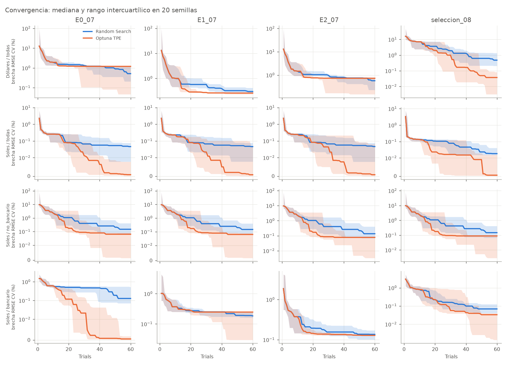
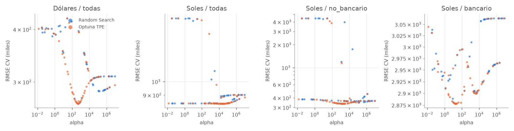
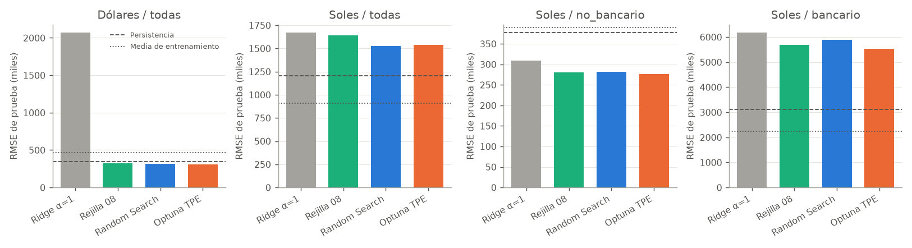

# Sesión IA07: optimización de hiperparámetros de Ridge con Random Search y Optuna TPE

**Estado:** pendiente de auditoría independiente y de revisión final. Resultados exploratorios.

## Resumen

Optimizar alpha importa mucho más que el método de búsqueda. Pasar de alpha = 1 a un alpha regularizado reduce el RMSE de validación una mediana de 51 %. Sobre esa base, Random Search y TPE cambian el resultado en menos de 1,5 %.

TPE converge algo antes en validación, pero tiene peor caso, y en prueba no aparece un ganador: TPE tiene menor RMSE en 8 estudios, Random Search en 7, y empatan en 1.

## Diseño

| Elemento | Decisión |
|---|---|
| Datos y partición | Los originales: 3.560 filas, 2.869 de entrenamiento (año objetivo hasta 2021) y 691 de prueba (2022–2025) |
| Modelo | Ridge con solver SVD |
| Cohortes | Dólares/todas, Soles/todas, Soles/no_bancario y Soles/bancario. Dólares/no_bancario coincide fila a fila con Dólares/todas |
| Características | Fijas por estudio: E0, E1 y E2 del notebook 07, y la especificación congelada por el notebook 08. Son 16 estudios |
| Validación | Ventanas expansivas del notebook 08: cuatro ventanas, dos en banca. Media del MSE por año de validación |
| Espacio | alpha log-uniforme entre 0,01 y 10.000.000; escalador standard o robust; recorte de ratios ninguno, p01_p99 o p05_p95 |
| Presupuesto | 60 trials por corrida y 20 semillas por método: 19.200 trials por método |
| Equivalencia | Mismo objetivo, ventanas, semillas y número de trials; solo cambia el muestreador (`RandomSampler` o `TPESampler`) |
| Prueba | Evaluación única de configuraciones congeladas con hash; no selecciona nada |

Los 10 primeros trials de TPE son aleatorios y, con la misma semilla, coinciden con los de Random Search. Los métodos solo pueden diferir desde el trial 11.

## Convergencia en validación

La brecha es la distancia, en % de RMSE de validación, al mejor valor conocido de cada estudio. La tabla resume la mediana de cada estudio en 20 semillas.

| Trials | Brecha mediana RS (%) | Brecha mediana TPE (%) | Estudios con menor mediana TPE / RS | Mann-Whitney p < 0,05 | Mann-Whitney Holm < 0,05 | Wilcoxon pareada p < 0,05 | Wilcoxon Holm < 0,05 |
|---|---:|---:|---:|---:|---:|---:|---:|
| 6 | 1,294 | 1,294 | 0 / 0 | 0 | 0 | 0 | 0 |
| 10 | 0,900 | 0,900 | 0 / 0 | 0 | 0 | 0 | 0 |
| 20 | 0,537 | 0,173 | 14 / 2 | 5 | 1 | 6 | 1 |
| 30 | 0,396 | 0,087 | 16 / 0 | 5 | 4 | 6 | 3 |
| 60 | 0,142 | 0,064 | 13 / 3 | 8 | 4 | 4 | 1 |

La unidad experimental es la corrida con una semilla (20 por estudio) y ambos métodos comparten semillas y sus 10 primeros trials (arranque de TPE), así que las observaciones están pareadas por semilla. La prueba adecuada es Wilcoxon de rangos con signo sobre las diferencias TPE − RS por semilla; Mann-Whitney supone independencia y se conserva solo como referencia histórica. La familia de hipótesis son las 16 comparaciones de estudios dentro de cada hito, con Holm aplicado por hito. Con Wilcoxon, los estudios que se sostienen tras Holm a 60 trials se reducen a uno (Soles/bancario E0); las configuraciones ganadoras y las métricas de prueba no cambian. El ajuste de Holm se añadió después de ver los valores sin ajustar.

TPE tiene ventaja mediana, pero muy pequeña: 0,69 puntos porcentuales como máximo con 60 trials. También tiene peor caso: su peor corrida con 60 trials queda a 7,05 % del mejor valor, frente a 2,96 % de Random Search, y su peor caso es mayor en 6 de 16 estudios. El ajuste de Holm se añadió después de ver los valores sin ajustar.

## Respuesta a los hiperparámetros

Alpha domina la respuesta. No recortar ratios aleja una mediana de 1,80 % del mejor resultado del estudio, mientras que p05_p95 (0,00 %) y p01_p99 (0,08 %) quedan casi empatados. El escalador robusto solo gana en Soles/todas, con alphas no comparables con los de StandardScaler. Es una lectura descriptiva ([efecto_categoricos.csv](efecto_categoricos.csv)), no una medida formal de importancia.

## Configuraciones ganadoras y resultado en prueba

Ganador de cada procedimiento por cohorte, elegido por validación con la semilla principal, y sus métricas de prueba. La selección completa está en [seleccion_congelada.csv](seleccion_congelada.csv) (SHA-256 `9ee2e553…`).

| Cohorte | Procedimiento | Características | alpha | Escalador | Recorte | RMSE CV | RMSE prueba | MAE prueba | R² prueba |
|---|---|---|---:|---|---|---:|---:|---:|---:|
| Dólares / todas | Ridge α=1 | seleccion_08 | 1,0 | standard | sin_recorte | 391.118 | 2.069.679 | 397.650 | −19,044 |
| Dólares / todas | Rejilla 08 | seleccion_08 | 1.000,0 | standard | p01_p99 | 270.452 | 323.977 | 147.873 | 0,509 |
| Dólares / todas | Random Search | seleccion_08 | 758,7 | standard | p05_p95 | 268.106 | 316.367 | 144.247 | 0,532 |
| Dólares / todas | Optuna TPE | seleccion_08 | 474,1 | standard | p01_p99 | 266.653 | 310.895 | 138.872 | 0,548 |
| Dólares / todas | Media de entrenamiento | — | — | — | — | — | 464.781 | 225.129 | −0,011 |
| Dólares / todas | Persistencia | — | — | — | — | — | 345.073 | 150.235 | 0,443 |
| Soles / todas | Ridge α=1 | seleccion_08 | 1,0 | standard | sin_recorte | 1.633.706 | 1.670.554 | 482.828 | −2,424 |
| Soles / todas | Rejilla 08 | seleccion_08 | 10,0 | standard | p01_p99 | 844.654 | 1.640.420 | 476.970 | −2,301 |
| Soles / todas | Random Search | seleccion_08 | 27.453,6 | robust | p05_p95 | 843.596 | 1.527.179 | 397.475 | −1,861 |
| Soles / todas | Optuna TPE | seleccion_08 | 23.993,5 | robust | p01_p99 | 843.434 | 1.539.278 | 399.018 | −1,907 |
| Soles / todas | Media de entrenamiento | — | — | — | — | — | 907.106 | 310.160 | −0,009 |
| Soles / todas | Persistencia | — | — | — | — | — | 1.204.777 | 346.717 | −0,781 |
| Soles / no_bancario | Ridge α=1 | E2_07 | 1,0 | standard | sin_recorte | 4.415.836 | 307.201 | 128.343 | 0,353 |
| Soles / no_bancario | Rejilla 08 | E2_07 | 1.000,0 | standard | p01_p99 | 338.385 | 278.745 | 117.603 | 0,467 |
| Soles / no_bancario | Random Search | E2_07 | 758,7 | standard | p05_p95 | 338.802 | 280.231 | 119.577 | 0,461 |
| Soles / no_bancario | Optuna TPE | seleccion_08 | 1.877,1 | standard | p05_p95 | 337.437 | 276.268 | 122.826 | 0,477 |
| Soles / no_bancario | Media de entrenamiento | — | — | — | — | — | 389.051 | 177.589 | −0,038 |
| Soles / no_bancario | Persistencia | — | — | — | — | — | 377.177 | 134.273 | 0,024 |
| Soles / bancario | Ridge α=1 | seleccion_08 | 1,0 | standard | sin_recorte | 2.914.212 | 6.174.950 | 4.792.807 | −6,656 |
| Soles / bancario | Rejilla 08 | seleccion_08 | 10,0 | standard | p01_p99 | 2.886.677 | 5.683.161 | 4.299.570 | −5,485 |
| Soles / bancario | Random Search | seleccion_08 | 9,4 | standard | sin_recorte | 2.881.308 | 5.890.436 | 4.472.641 | −5,967 |
| Soles / bancario | Optuna TPE | seleccion_08 | 19,0 | standard | sin_recorte | 2.878.338 | 5.528.768 | 4.139.118 | −5,138 |
| Soles / bancario | Media de entrenamiento | — | — | — | — | — | 2.231.691 | 1.198.726 | 0,000 |
| Soles / bancario | Persistencia | — | — | — | — | — | 3.115.421 | 1.686.145 | −0,949 |

"Ridge α=1" aplica el baseline del 07 a cada especificación. Su fila de Dólares/todas usa la especificación del 08, no la del 07: el baseline original E0 del 07 tiene un RMSE de prueba de 804.755, reproducido exactamente.

**Lectura:**
- **Dólares y Soles/no_bancario:** los modelos optimizados (rejilla, Random Search y TPE) superan en RMSE a persistencia y a la media de entrenamiento.
- **Soles/todas:** ningún ajustado supera a esas referencias, y la banca pesa mucho en su error.
- **Soles/bancario:** todos los ajustados son peores que la media de entrenamiento, con R² negativo, y los ganadores de validación también son peores que persistencia. En esta cohorte el ganador por validación es peor en prueba que otras especificaciones; esa selección no se cambia.
- **TPE frente a Random Search en prueba:** las diferencias llegan a 10,4 %, muy por encima de las de validación (0,56 % como máximo). Configuraciones casi equivalentes en validación generalizan distinto. Con una sola semilla evaluada en prueba, eso no se puede atribuir al muestreador.
- **Frente a la rejilla en validación:** TPE mejora en los 16 estudios y Random Search en 11, siempre por menos de 1,5 %. En 5 estudios Random Search queda peor que la rejilla pese a usar 60 trials frente a 6.

## Limitaciones del pruning y del early stopping en Ridge

**No se implementó ninguno**, y todos los estudios usan `NopPruner`.

- **Early stopping:** Ridge con solver SVD tiene solución cerrada. No hay iteraciones ni curva de aprendizaje que vigilar. Los solvers iterativos (`sag`, `saga`, `lsqr`) se detienen por convergencia numérica hacia la misma solución, no por generalización, así que usarlos para crear pasos sería artificial.
- **Pruning:** Optuna necesita valores intermedios. En Ridge el único paso intermedio posible son las ventanas temporales, que no son réplicas intercambiables: el error depende mucho del periodo.
- **Costo:** un trial tarda una mediana de 13 ms en Random Search y 17 ms en TPE (las medias son 23 y 27 ms). El pruning ahorraría muy poco y rompería la igualdad de presupuesto entre métodos.

Riesgo medido con los trials de Random Search ya registrados, sin ejecutar ningún pruner ([diagnostico_pruning.csv](diagnostico_pruning.csv)): tras la primera ventana, la correlación de Spearman entre el error parcial y el final va de −0,36 a 0,91, con mediana 0,21. Una regla de mediana habría descartado al ganador en alguna semilla en 10 de 16 estudios, y en todas las semillas en tres estudios de Soles/todas.

## Límites del resultado

- **Prueba no confirmatoria:** la prueba 2022–2025 ya se inspeccionó en los notebooks 07 y 08. Esta evaluación sirve de contraste, no de confirmación independiente.
- **Optimismo de seleccion_08:** esa especificación se eligió en las mismas ventanas de validación empleadas aquí, así que su error de validación es optimista y favorece que gane su cohorte; no es una validación independiente, sino una comparación sobre ventanas relacionadas.
- **Una sola semilla en prueba:** las otras 19 solo se usan para la convergencia en validación.
- **Pruebas estadísticas:** las semillas se tratan como réplicas de los métodos, no de los datos. Los valores p no dicen nada sobre otros periodos o empresas.
- **Alcance:** solo Ridge, en un espacio pequeño y barato. No se extrapola a modelos con más hiperparámetros, donde TPE y el pruning pueden comportarse distinto.
- **Datos:** el objetivo es el FCL preliminar, no un FCFF validado. Siguen sin acreditarse la escala monetaria ni la disponibilidad temporal de los datos, y la especificación con niveles de t requiere conocer esos estados al pronosticar.
