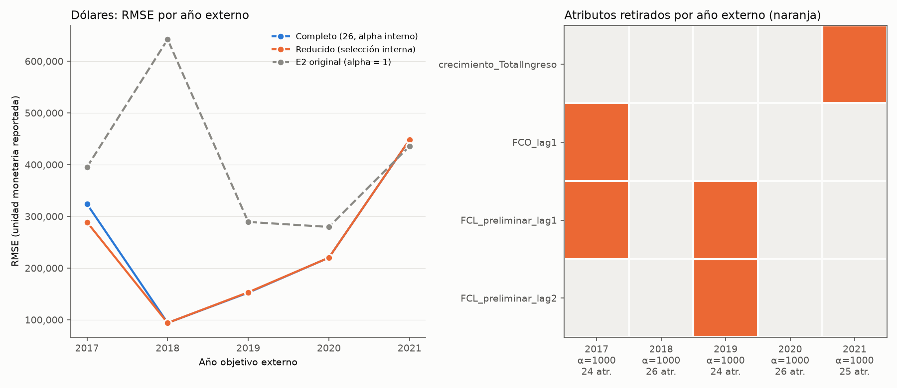
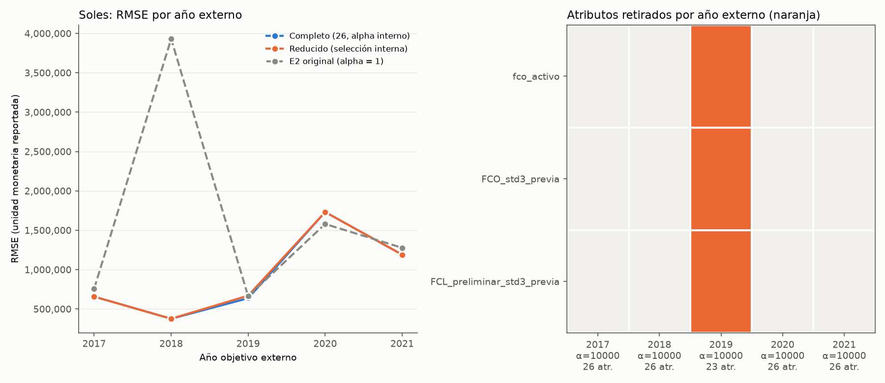
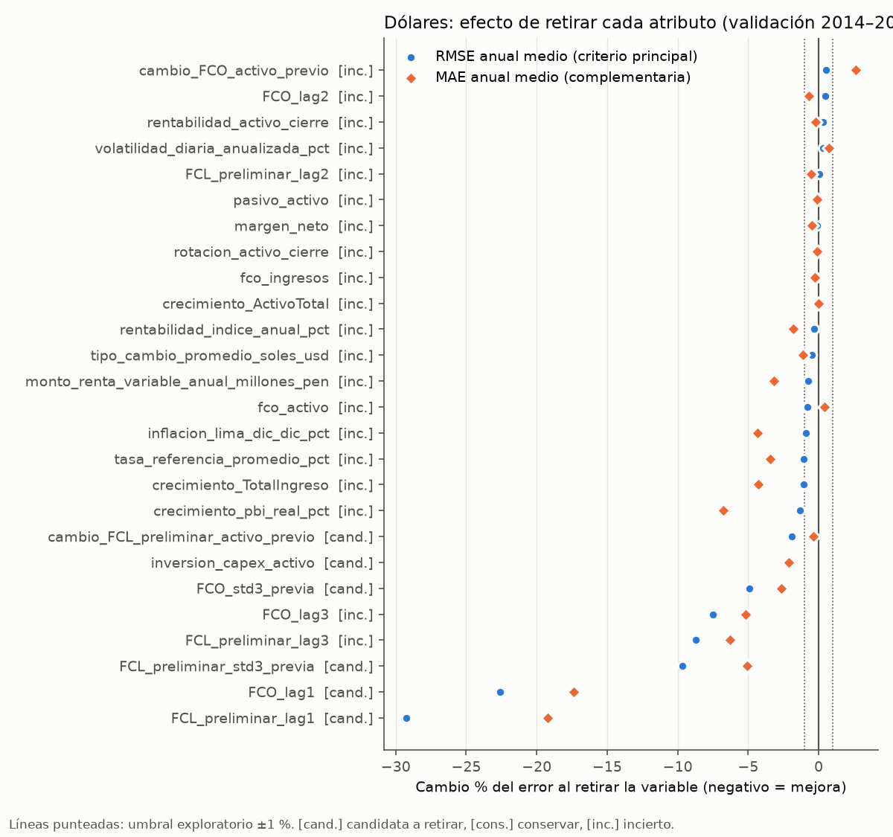
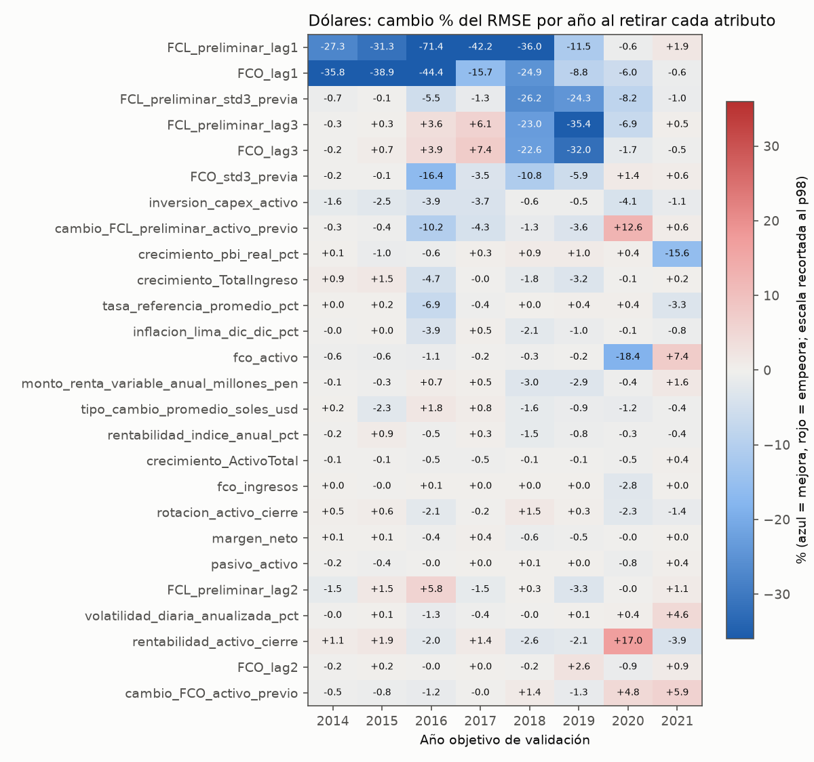
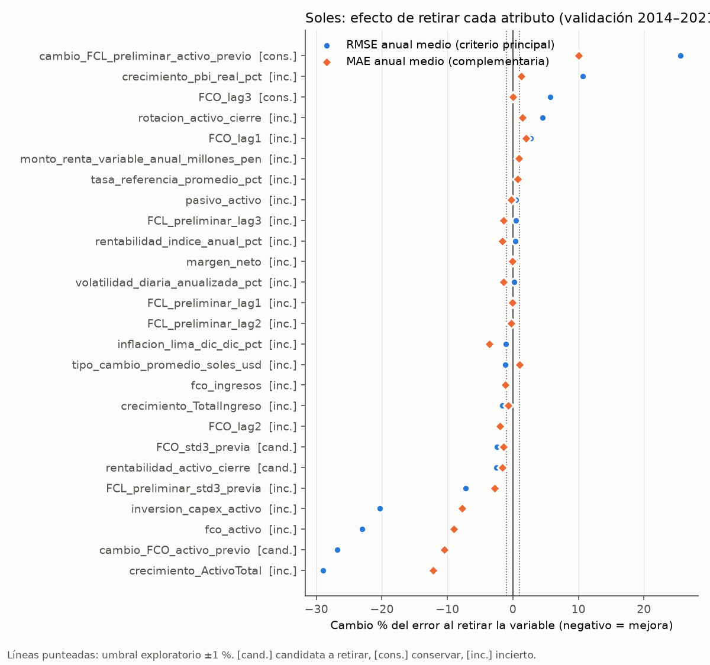
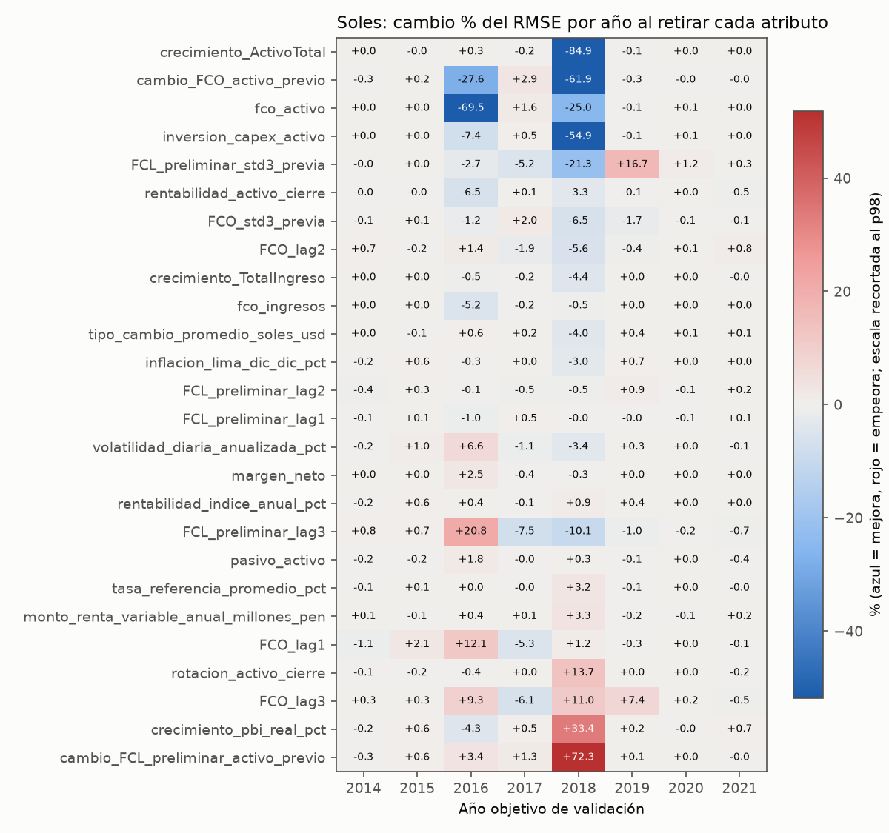

# Sprint 08 — Etapa 2: ¿qué variables perjudican la predicción del FCL preliminar?

Solo entrenamiento (2.869 filas, años objetivo 2006–2021), por moneda; prueba 2022–2025 no interviene. Parte A (principal): validación temporal anidada que separa selección y evaluación. Parte B: diagnóstico de ablación individual con Ridge(alpha = 1).

## Respuesta breve

- **D lares: Evidencia insuficiente.** El procedimiento reducido cambia el RMSE anual medio externo -2.74 % y el MAE -1.41 % frente al completo con alpha interno; mejora en 1 de 5 años; peor año +0.54 %. Lista propuesta con todo el entrenamiento: retirar crecimiento_pbi_real_pct (pendiente de evaluación posterior).
- **Soles: Conservar modelo completo.** El procedimiento reducido cambia el RMSE anual medio externo +0.71 % y el MAE +0.45 % frente al completo con alpha interno; mejora en 0 de 5 años; peor año +5.14 %. Lista propuesta con todo el entrenamiento: retirar nada (pendiente de evaluación posterior).
- **El efecto dominante es la regularización, no la retirada de variables:** E2 con alpha = 1 tiene un RMSE anual medio externo D lares +64.8 %; Soles +78.7 % respecto al completo con alpha interno. Las mejoras de la ablación individual (Parte B, alpha = 1) son compatibles con compensar una regularización insuficiente: con alpha elegido internamente, retirar variables ya no mejora de forma consistente.
- Alpha elegido en el máximo de la rejilla (10000) en D lares 1 de 10 selecciones; Soles 10 de 10 selecciones: la rejilla predefinida puede quedar corta por arriba. No se amplía a posteriori; debe revisarse en una etapa posterior con un protocolo nuevo.
- Los problemas de calidad de la Etapa 1 (extremos, VIF, faltantes) no se usan como criterio de retirada; solo cuenta el efecto sobre el error fuera de muestra.

## Auditoría previa e inconsistencias documentadas

- Verificado contra el código: 26 atributos y orden (notebook 07 celda 10, `validacion_baseline.json`, `especificacion_e2.json`); objetivo FCO+CAPEX de t+1 por unión Ejercicio+1 exacta; elegibilidad objetivo no faltante y misma moneda; particiones 2.869/691; Pipeline mediana (`keep_empty_features=True`) + StandardScaler + Ridge(alpha=1, solver="svd") por moneda. La réplica reproduce las predicciones E2 de entrenamiento del notebook 07 con diferencia D lares 0e+00, Soles 0e+00.
- `src/feature_engineering.make_preprocessor` usa RobustScaler: no es la configuración E2 (sensibilidad en Sprint 06); se usa StandardScaler.
- La validación de Sprint 06 (notebook 08) eligió alpha por MSE anual medio con recorte p1/p99 y niveles t: no es E2. Se reutilizan solo su regla de pliegues (calentamiento 8 años, ventanas expansivas por año objetivo) y su rejilla de alpha; el criterio interno aquí es el RMSE anual medio.
- Los bloques de 2 años de Sprint 06 sirven para el diagnóstico individual (Parte B) pero no como pliegues externos anidados: 2014–2015 no dejan historia para una validación interna.
- La etiqueta de dólares es `D lares` en la fuente; se conserva.
- `notebooks/03_extraccion_macroeconomica.ipynb` y `reports/auditoria_extraccion_macroeconomica.md` tienen cambios del usuario sin commit; hacen fallar las pruebas de integridad de Sprint 07 y de la Etapa 1 (detección correcta, ajena a esta etapa). No se modificaron.

## Parte A — Validación temporal anidada (alternativa principal)

**Propósito.** Estimar el desempeño de un procedimiento de selección (atributos y alpha) frente al modelo completo con alpha seleccionado, separando selección (validación interna, solo pasado) y evaluación (año externo no usado en decisiones). La evaluación externa estima el desempeño del procedimiento, no demuestra que una lista fija sea óptima.

### A.1 Protocolo (fijado antes de ejecutar)

- Años externos: 2017, 2018, 2019, 2020, 2021; todas las filas con anio_objetivo < año externo, misma moneda.
- Validación interna: los 3 años objetivo inmediatamente anteriores al año externo; cada uno con ventana expansiva (entrena con años anteriores) y al menos 8 años de historia; por eso el primer año externo es 2017. Se conserva la unidad año objetivo, las ventanas expansivas y el calentamiento de 8 años de Sprint 06. Sus bloques de 2 años no se reutilizan como pliegues externos porque los primeros (2014–2015) no dejan historia para una validación interna.
- Rejilla de alpha (de Sprint 06): 0.1, 1, 10, 100, 1000, 10000; mínimo RMSE anual medio interno; empate (diferencia relativa <= 1e-9): mayor alpha.
- Eliminación hacia atrás: evaluar retirar cada atributo restante (alpha reajustado para cada subconjunto con la misma rejilla y pliegues internos); retirada con menor RMSE anual medio interno; empate: primer atributo en el orden E2; aceptación: mejora relativa >= 1 % del RMSE interno medio Y RMSE menor en >= 2 de 3 años internos; máximo 5 retiradas.
- Regla de recomendación: reducir solo si RMSE anual medio externo del reducido <= -1 % frente al completo, mejora en >= 4 de 5 años, MAE anual medio no peor y peor empeoramiento anual <= 5 %; conservar el completo si RMSE anual medio externo del reducido >= completo o reducido peor en la mayoría de años; si no, evidencia insuficiente.
- Las métricas usan solo años objetivo ≤ 2021. Ambas monedas tienen 16 años (2006–2021), suficientes para la regla de 8 años de historia; en dólares cada año externo tiene solo 21–28 filas.

### A.2 Pliegues externos e internos

| moneda | anio_externo | n_train | empresas_train | n_externo | empresas_externo |
|---|---|---|---|---|---|
| D lares | 2017 | 234 | 43 | 21 | 21 |
| D lares | 2018 | 255 | 43 | 25 | 25 |
| D lares | 2019 | 280 | 47 | 26 | 26 |
| D lares | 2020 | 306 | 48 | 24 | 24 |
| D lares | 2021 | 330 | 48 | 23 | 23 |
| Soles | 2017 | 1687 | 246 | 177 | 177 |
| Soles | 2018 | 1864 | 256 | 169 | 169 |
| Soles | 2019 | 2033 | 261 | 162 | 162 |
| Soles | 2020 | 2195 | 263 | 161 | 161 |
| Soles | 2021 | 2356 | 264 | 160 | 160 |

Pliegues internos (años de validación y tamaños): `anidada_pliegues_internos.csv`.

### A.3 Resultados — D lares

**Recomendación (regla declarada): Evidencia insuficiente.**

- RMSE anual medio externo: completo 247,885; reducido 241,099 (-2.74 %); E2 con alpha = 1: 408,560 (+64.82 %).
- MAE anual medio: completo 128,570; reducido 126,761 (-1.41 %).
- Métricas concatenadas (ponderan años por n; no son el criterio): RMSE reducido -2.52 %, MAE -1.25 % frente al completo.
- Reducido frente a completo por año: mejora en 1, empeora en 2, empata en 2 de 5; mediana +0.00 %; peor empeoramiento anual +0.54 % (2019).
- Atributos retirados por pliegue: 2017: FCO_lag1, FCL_preliminar_lag1 (α completo 10000, α reducido 1000); 2018: ninguno (α completo 1000, α reducido 1000); 2019: FCL_preliminar_lag1, FCL_preliminar_lag2 (α completo 1000, α reducido 1000); 2020: ninguno (α completo 1000, α reducido 1000); 2021: crecimiento_TotalIngreso (α completo 1000, α reducido 1000).
- Frecuencia de retirada: `FCL_preliminar_lag1` 2/5, `crecimiento_TotalIngreso` 1/5, `FCO_lag1` 1/5, `FCL_preliminar_lag2` 1/5. Una frecuencia alta indica selección repetida por este procedimiento, no irrelevancia universal.

| año externo | ΔRMSE reducido % | ΔRMSE E2 α=1 % |
|---|---|---|
| 2017 | -10.81 | +22.01 |
| 2018 | +0.00 | +582.02 |
| 2019 | +0.54 | +89.62 |
| 2020 | +0.00 | +26.95 |
| 2021 | +0.06 | -2.73 |

- **Lista candidata final (propuesta pendiente de evaluación posterior):** el procedimiento ajustado con todo el entrenamiento hasta 2021 (años internos 2019;2020;2021) retira crecimiento_pbi_real_pct con alpha 1000 (alpha del completo 1000). Las métricas externas anteriores no corresponden a esta lista.

### A.3 Resultados — Soles

**Recomendación (regla declarada): Conservar modelo completo.**

- RMSE anual medio externo: completo 918,755; reducido 925,301 (+0.71 %); E2 con alpha = 1: 1,641,968 (+78.72 %).
- MAE anual medio: completo 253,864; reducido 255,010 (+0.45 %).
- Métricas concatenadas (ponderan años por n; no son el criterio): RMSE reducido +0.39 %, MAE +0.45 % frente al completo.
- Reducido frente a completo por año: mejora en 0, empeora en 1, empata en 4 de 5; mediana +0.00 %; peor empeoramiento anual +5.14 % (2019).
- Atributos retirados por pliegue: 2017: ninguno (α completo 10000, α reducido 10000); 2018: ninguno (α completo 10000, α reducido 10000); 2019: fco_activo, FCO_std3_previa, FCL_preliminar_std3_previa (α completo 10000, α reducido 10000); 2020: ninguno (α completo 10000, α reducido 10000); 2021: ninguno (α completo 10000, α reducido 10000).
- Frecuencia de retirada: `fco_activo` 1/5, `FCO_std3_previa` 1/5, `FCL_preliminar_std3_previa` 1/5. Una frecuencia alta indica selección repetida por este procedimiento, no irrelevancia universal.

| año externo | ΔRMSE reducido % | ΔRMSE E2 α=1 % |
|---|---|---|
| 2017 | +0.00 | +15.48 |
| 2018 | +0.00 | +943.84 |
| 2019 | +5.14 | +3.93 |
| 2020 | +0.00 | -8.75 |
| 2021 | +0.00 | +7.27 |

- **Lista candidata final (propuesta pendiente de evaluación posterior):** el procedimiento ajustado con todo el entrenamiento hasta 2021 (años internos 2019;2020;2021) retira ningún atributo con alpha 1000 (alpha del completo 1000). Las métricas externas anteriores no corresponden a esta lista.

## Parte B — Diagnóstico de ablación individual (condicionado a Ridge con alpha = 1; no es selección definitiva)

**Pregunta.** ¿Retirar una variable reduce el error de predicción de forma consistente en validación temporal dentro de entrenamiento? **Alcance.** Conclusiones limitadas a Ridge(alpha=1.0) con mediana + StandardScaler, por moneda, objetivo FCL_preliminar(t+1) y años objetivo de validación 2014–2021. No se afirma que una variable sea inútil para otros modelos, configuraciones o periodos.

### 1. Método

- **Datos:** solo entrenamiento (2.869 filas, años objetivo 2006–2021); el panel se carga, se verifica y se separa de inmediato. Prueba 2022–2025 no participa en filas, objetivos, predicciones ni métricas.
- **Modelo:** Pipeline([('preparacion', ColumnTransformer([('numericas', Pipeline([('imputer', SimpleImputer(strategy='median', keep_empty_features=True)), ('scaler', StandardScaler())]), columnas)], remainder='drop')), ('ridge', Ridge(alpha=1.0, solver='svd', fit_intercept=True))]), uno por moneda, nuevo para cada variante y pliegue. Réplica verificada: con todo el entrenamiento reproduce las predicciones E2 de entrenamiento del notebook 07 (diferencia relativa máxima: D lares 0.0e+00, Soles 0.0e+00).
- **Pliegues:** Años objetivo ordenados; calentamiento 8 años (si hay >= 12); bloques de validación de 2 años; entrenamiento expansivo con todos los años anteriores al bloque. Origen: notebooks/08_mejoras_baseline.ipynb celda 16 (cohorte todas); tamaños contrastados con reports/sprint_06/mejoras/cv_folds.csv. Los ocho primeros años objetivo (2006–2013) solo entrenan.
- **Métricas:** delta = error sin la variable − error de referencia (negativo = mejora); cambio % = 100·delta/referencia. Criterio principal: promedio simple del RMSE anual de los 8 años 2014–2021; MAE anual medio complementario; métricas concatenadas como contraste (ponderan por n).
- **Regla de clasificación (fijada antes de ejecutar):** candidata si el RMSE anual medio baja ≥ 1 %, mejora en ≥ 6 de 8 años, la mediana anual es negativa y el MAE anual medio no empeora; conservar con la condición simétrica; incierto en otro caso. Empate: |delta| ≤ 1e-06 × error de referencia. El 1 % y el 75 % son umbrales exploratorios.

### Síntesis

- **D lares:** candidatas bajo la regla principal: `FCL_preliminar_lag1`, `FCL_preliminar_std3_previa`, `FCO_lag1`, `FCO_std3_previa`, `cambio_FCL_preliminar_activo_previo`, `inversion_capex_activo`; también candidatas al excluir la observación y la empresa dominantes: `FCL_preliminar_std3_previa`, `FCO_lag1`.
- **Soles:** candidatas bajo la regla principal: `FCO_std3_previa`, `cambio_FCO_activo_previo`, `rentabilidad_activo_cierre`; también candidatas al excluir la observación y la empresa dominantes: ninguna.
- Ninguna conclusión justifica retirar variables todavía: el RMSE anual depende de pocas empresas (D lares: CM0006 en 6 año(s), B20027 en 1 año(s); Soles: OE3108 en 2 año(s), B80004 en 2 año(s), B80005 en 1 año(s), OE6928 en 1 año(s) concentran ≥ 50 % del error cuadrático del año) y las candidatas se eligieron con la misma validación. Son hipótesis para confirmar con datos independientes.
- Problemas de calidad del dato (Etapa 1) y perjuicio predictivo son cosas distintas: aquí solo se mide el efecto marginal sobre el error de este Ridge.

### 2. Pliegues y tamaños

| moneda | fold | anios_objetivo_train | anios_objetivo_validacion | n_train | empresas_train | n_validacion | empresas_validacion | evaluable |
|---|---|---|---|---|---|---|---|---|
| D lares | 0 |  | 2006-2013 | 0 | 0 | 154 | 0 | False |
| D lares | 1 | 2006-2013 | 2014;2015 | 154 | 36 | 54 | 28 | True |
| D lares | 2 | 2006-2015 | 2016;2017 | 208 | 39 | 47 | 26 | True |
| D lares | 3 | 2006-2017 | 2018;2019 | 255 | 43 | 51 | 28 | True |
| D lares | 4 | 2006-2019 | 2020;2021 | 306 | 48 | 47 | 26 | True |
| Soles | 0 |  | 2006-2013 | 0 | 0 | 1155 | 0 | False |
| Soles | 1 | 2006-2013 | 2014;2015 | 1155 | 227 | 357 | 186 | True |
| Soles | 2 | 2006-2015 | 2016;2017 | 1512 | 241 | 352 | 187 | True |
| Soles | 3 | 2006-2017 | 2018;2019 | 1864 | 256 | 331 | 175 | True |
| Soles | 4 | 2006-2019 | 2020;2021 | 2195 | 263 | 321 | 166 | True |

### 3. Resultados — D lares

Referencia (26 atributos): RMSE anual medio 565,804; MAE anual medio 226,930; RMSE concatenado 589,706; MAE concatenado 225,852 (unidad monetaria reportada).

1. **Candidatas a retirar:** `FCL_preliminar_lag1`, `FCO_lag1`, `FCL_preliminar_std3_previa`, `FCO_std3_previa`, `inversion_capex_activo`, `cambio_FCL_preliminar_activo_previo` (mejora concentrada: mediana anual -0.84 %, 33% del cambio absoluto en 2016)
2. **Cambio de RMSE y MAE al retirar cada variable:** tabla siguiente (y `resumen_ablacion.csv`).
3. **Años con mejora/empeoramiento:** columnas "mejora/empeora" y años listados; detalle anual en `comparaciones_pareadas.csv` y en `graficos/estabilidad_anual_dolares.png`.
4. **Resultados inciertos (20):** `FCL_preliminar_lag3`, `FCO_lag3`, `crecimiento_pbi_real_pct`, `crecimiento_TotalIngreso`, `tasa_referencia_promedio_pct`, `inflacion_lima_dic_dic_pct`, `fco_activo`, `monto_renta_variable_anual_millones_pen`, `tipo_cambio_promedio_soles_usd`, `rentabilidad_indice_anual_pct`, `crecimiento_ActivoTotal`, `fco_ingresos`, `rotacion_activo_cierre`, `margen_neto`, `pasivo_activo`, `FCL_preliminar_lag2`, `volatilidad_diaria_anualizada_pct`, `rentabilidad_activo_cierre`, `FCO_lag2`, `cambio_FCO_activo_previo`.
   **Conservar (0):** ninguna.
5. **Retirada conjunta** (FCL_preliminar_lag1, FCL_preliminar_std3_previa, FCO_lag1, FCO_std3_previa, cambio_FCL_preliminar_activo_previo, inversion_capex_activo): RMSE anual medio -35.51 %, MAE -23.72 %, mejora en 7/8 años; concatenado RMSE -35.63 %. La mejora se mantiene bajo la misma regla. Mejor cambio individual: -29.24 %. Exploratorio: mismas validaciones que eligieron las candidatas.

| atributo | ΔRMSE anual medio % | ΔMAE anual medio % | mediana ΔRMSE anual % | años mejora RMSE | años empeora RMSE | empates RMSE | años mejora MAE | ΔRMSE concat. % | ΔMAE concat. % | años que mejora (RMSE) | clasificación |
|---|---|---|---|---|---|---|---|---|---|---|---|
| FCL_preliminar_lag1 | -29.24 | -19.21 | -29.29 | 7 | 1 | 0 | 8 | -26.91 | -19.44 | 2014;2015;2016;2017;2018;2019;2020 | Candidata a retirar |
| FCO_lag1 | -22.58 | -17.36 | -20.32 | 8 | 0 | 0 | 8 | -21.63 | -17.94 | 2014;2015;2016;2017;2018;2019;2020;2021 | Candidata a retirar |
| FCL_preliminar_std3_previa | -9.64 | -5.09 | -3.37 | 8 | 0 | 0 | 8 | -10.42 | -5.15 | 2014;2015;2016;2017;2018;2019;2020;2021 | Candidata a retirar |
| FCL_preliminar_lag3 | -8.70 | -6.31 | -0.00 | 4 | 4 | 0 | 5 | -9.70 | -6.52 | 2014;2018;2019;2020 | Resultado incierto |
| FCO_lag3 | -7.50 | -5.18 | -0.36 | 5 | 3 | 0 | 5 | -8.59 | -5.37 | 2014;2018;2019;2020;2021 | Resultado incierto |
| FCO_std3_previa | -4.93 | -2.67 | -1.83 | 6 | 2 | 0 | 6 | -5.13 | -2.64 | 2014;2015;2016;2017;2018;2019 | Candidata a retirar |
| inversion_capex_activo | -2.08 | -2.13 | -2.06 | 8 | 0 | 0 | 8 | -1.90 | -2.13 | 2014;2015;2016;2017;2018;2019;2020;2021 | Candidata a retirar |
| cambio_FCL_preliminar_activo_previo | -1.93 | -0.39 | -0.84 | 6 | 2 | 0 | 5 | -2.43 | -0.40 | 2014;2015;2016;2017;2018;2019 | Candidata a retirar |
| crecimiento_pbi_real_pct | -1.32 | -6.75 | 0.21 | 3 | 5 | 0 | 5 | -0.69 | -6.37 | 2015;2016;2021 | Resultado incierto |
| crecimiento_TotalIngreso | -1.06 | -4.29 | -0.08 | 5 | 3 | 0 | 6 | -1.20 | -4.24 | 2016;2017;2018;2019;2020 | Resultado incierto |
| tasa_referencia_promedio_pct | -1.05 | -3.45 | 0.02 | 3 | 5 | 0 | 6 | -0.82 | -3.41 | 2016;2017;2021 | Resultado incierto |
| inflacion_lima_dic_dic_pct | -0.92 | -4.32 | -0.43 | 6 | 2 | 0 | 5 | -0.93 | -4.45 | 2014;2016;2018;2019;2020;2021 | Resultado incierto |
| fco_activo | -0.82 | 0.41 | -0.43 | 7 | 1 | 0 | 6 | -0.37 | 0.24 | 2014;2015;2016;2017;2018;2019;2020 | Resultado incierto |
| monto_renta_variable_anual_millones_pen | -0.73 | -3.16 | -0.22 | 5 | 3 | 0 | 6 | -1.00 | -3.34 | 2014;2015;2018;2019;2020 | Resultado incierto |
| tipo_cambio_promedio_soles_usd | -0.48 | -1.09 | -0.66 | 5 | 3 | 0 | 5 | -0.59 | -1.14 | 2015;2018;2019;2020;2021 | Resultado incierto |
| rentabilidad_indice_anual_pct | -0.32 | -1.79 | -0.38 | 6 | 2 | 0 | 6 | -0.33 | -1.74 | 2014;2016;2018;2019;2020;2021 | Resultado incierto |
| crecimiento_ActivoTotal | -0.19 | 0.01 | -0.12 | 7 | 1 | 0 | 6 | -0.17 | -0.00 | 2014;2015;2016;2017;2018;2019;2020 | Resultado incierto |
| fco_ingresos | -0.14 | -0.29 | 0.01 | 2 | 6 | 0 | 6 | -0.05 | -0.29 | 2015;2020 | Resultado incierto |
| rotacion_activo_cierre | -0.14 | -0.10 | 0.08 | 4 | 4 | 0 | 4 | 0.07 | -0.04 | 2016;2017;2020;2021 | Resultado incierto |
| margen_neto | -0.13 | -0.46 | -0.01 | 4 | 4 | 0 | 5 | -0.16 | -0.48 | 2016;2018;2019;2020 | Resultado incierto |
| pasivo_activo | -0.07 | -0.12 | 0.01 | 4 | 4 | 0 | 4 | -0.06 | -0.14 | 2014;2015;2016;2020 | Resultado incierto |
| FCL_preliminar_lag2 | 0.06 | -0.55 | 0.11 | 4 | 4 | 0 | 6 | -0.15 | -0.47 | 2014;2017;2019;2020 | Resultado incierto |
| volatilidad_diaria_anualizada_pct | 0.30 | 0.71 | 0.06 | 4 | 4 | 0 | 3 | 0.17 | 0.57 | 2014;2016;2017;2018 | Resultado incierto |
| rentabilidad_activo_cierre | 0.30 | -0.22 | -0.45 | 4 | 4 | 0 | 4 | -0.22 | -0.23 | 2016;2018;2019;2021 | Resultado incierto |
| FCO_lag2 | 0.48 | -0.70 | -0.01 | 4 | 4 | 0 | 4 | 0.67 | -0.64 | 2014;2016;2018;2020 | Resultado incierto |
| cambio_FCO_activo_previo | 0.50 | 2.61 | -0.28 | 5 | 3 | 0 | 3 | 0.08 | 2.49 | 2014;2015;2016;2017;2019 | Resultado incierto |

### 3. Resultados — Soles

Referencia (26 atributos): RMSE anual medio 1,436,945; MAE anual medio 284,110; RMSE concatenado 1,822,292; MAE concatenado 282,415 (unidad monetaria reportada).

1. **Candidatas a retirar:** `cambio_FCO_activo_previo` (mejora concentrada: mediana anual -0.14 %, 78% del cambio absoluto en 2018), `rentabilidad_activo_cierre` (mejora concentrada: mediana anual -0.06 %, 53% del cambio absoluto en 2016), `FCO_std3_previa` (mejora concentrada: mediana anual -0.11 %, 82% del cambio absoluto en 2018)
2. **Cambio de RMSE y MAE al retirar cada variable:** tabla siguiente (y `resumen_ablacion.csv`).
3. **Años con mejora/empeoramiento:** columnas "mejora/empeora" y años listados; detalle anual en `comparaciones_pareadas.csv` y en `graficos/estabilidad_anual_soles.png`.
4. **Resultados inciertos (21):** `crecimiento_ActivoTotal`, `fco_activo`, `inversion_capex_activo`, `FCL_preliminar_std3_previa`, `FCO_lag2`, `crecimiento_TotalIngreso`, `fco_ingresos`, `tipo_cambio_promedio_soles_usd`, `inflacion_lima_dic_dic_pct`, `FCL_preliminar_lag2`, `FCL_preliminar_lag1`, `volatilidad_diaria_anualizada_pct`, `margen_neto`, `rentabilidad_indice_anual_pct`, `FCL_preliminar_lag3`, `pasivo_activo`, `tasa_referencia_promedio_pct`, `monto_renta_variable_anual_millones_pen`, `FCO_lag1`, `rotacion_activo_cierre`, `crecimiento_pbi_real_pct`.
   **Conservar (2):** `FCO_lag3`, `cambio_FCL_preliminar_activo_previo`.
5. **Retirada conjunta** (FCO_std3_previa, cambio_FCO_activo_previo, rentabilidad_activo_cierre): RMSE anual medio -24.19 %, MAE -10.66 %, mejora en 6/8 años; concatenado RMSE -33.76 %. La mejora se mantiene bajo la misma regla. Mejor cambio individual: -26.81 %. Exploratorio: mismas validaciones que eligieron las candidatas.

| atributo | ΔRMSE anual medio % | ΔMAE anual medio % | mediana ΔRMSE anual % | años mejora RMSE | años empeora RMSE | empates RMSE | años mejora MAE | ΔRMSE concat. % | ΔMAE concat. % | años que mejora (RMSE) | clasificación |
|---|---|---|---|---|---|---|---|---|---|---|---|
| crecimiento_ActivoTotal | -28.97 | -12.19 | 0.00 | 4 | 4 | 0 | 6 | -33.90 | -12.18 | 2015;2017;2018;2019 | Resultado incierto |
| cambio_FCO_activo_previo | -26.81 | -10.46 | -0.14 | 6 | 2 | 0 | 5 | -36.79 | -10.53 | 2014;2016;2018;2019;2020;2021 | Candidata a retirar |
| fco_activo | -23.04 | -9.02 | 0.02 | 3 | 5 | 0 | 3 | -26.31 | -9.22 | 2016;2018;2019 | Resultado incierto |
| inversion_capex_activo | -20.29 | -7.76 | 0.02 | 3 | 5 | 0 | 3 | -28.74 | -7.77 | 2016;2018;2019 | Resultado incierto |
| FCL_preliminar_std3_previa | -7.24 | -2.82 | -0.01 | 4 | 4 | 0 | 4 | -12.16 | -2.91 | 2014;2016;2017;2018 | Resultado incierto |
| rentabilidad_activo_cierre | -2.53 | -1.62 | -0.06 | 6 | 2 | 0 | 5 | -3.36 | -1.62 | 2014;2015;2016;2018;2019;2021 | Candidata a retirar |
| FCO_std3_previa | -2.44 | -1.40 | -0.11 | 6 | 2 | 0 | 7 | -3.96 | -1.40 | 2014;2016;2018;2019;2020;2021 | Candidata a retirar |
| FCO_lag2 | -1.65 | -1.93 | -0.06 | 4 | 4 | 0 | 6 | -2.87 | -1.94 | 2015;2017;2018;2019 | Resultado incierto |
| crecimiento_TotalIngreso | -1.64 | -0.73 | -0.00 | 4 | 3 | 1 | 5 | -2.66 | -0.74 | 2016;2017;2018;2021 | Resultado incierto |
| fco_ingresos | -1.26 | -1.16 | 0.00 | 3 | 5 | 0 | 4 | -1.42 | -1.20 | 2016;2017;2018 | Resultado incierto |
| tipo_cambio_promedio_soles_usd | -1.18 | 1.01 | 0.08 | 2 | 6 | 0 | 1 | -2.11 | 1.02 | 2015;2018 | Resultado incierto |
| inflacion_lima_dic_dic_pct | -1.03 | -3.64 | 0.01 | 3 | 5 | 0 | 7 | -1.78 | -3.76 | 2014;2016;2018 | Resultado incierto |
| FCL_preliminar_lag2 | -0.18 | -0.29 | -0.09 | 5 | 3 | 0 | 6 | -0.33 | -0.29 | 2014;2016;2017;2018;2020 | Resultado incierto |
| FCL_preliminar_lag1 | -0.18 | -0.09 | -0.02 | 5 | 3 | 0 | 5 | -0.23 | -0.07 | 2014;2016;2018;2019;2020 | Resultado incierto |
| volatilidad_diaria_anualizada_pct | 0.21 | -1.44 | -0.02 | 4 | 4 | 0 | 5 | -0.41 | -1.62 | 2014;2017;2018;2021 | Resultado incierto |
| margen_neto | 0.40 | -0.08 | 0.01 | 2 | 6 | 0 | 4 | 0.38 | -0.09 | 2017;2018 | Resultado incierto |
| rentabilidad_indice_anual_pct | 0.41 | -1.59 | 0.20 | 2 | 6 | 0 | 6 | 0.60 | -1.67 | 2014;2017 | Resultado incierto |
| FCL_preliminar_lag3 | 0.42 | -1.45 | -0.46 | 5 | 3 | 0 | 3 | -0.50 | -1.41 | 2017;2018;2019;2020;2021 | Resultado incierto |
| pasivo_activo | 0.44 | -0.23 | -0.05 | 5 | 3 | 0 | 5 | 0.58 | -0.23 | 2014;2015;2017;2019;2021 | Resultado incierto |
| tasa_referencia_promedio_pct | 1.09 | 0.78 | 0.01 | 4 | 4 | 0 | 4 | 1.86 | 0.72 | 2014;2017;2019;2021 | Resultado incierto |
| monto_renta_variable_anual_millones_pen | 1.22 | 0.94 | 0.10 | 3 | 5 | 0 | 1 | 2.01 | 1.08 | 2015;2019;2020 | Resultado incierto |
| FCO_lag1 | 2.70 | 2.04 | -0.06 | 4 | 4 | 0 | 3 | 3.47 | 2.11 | 2014;2017;2019;2021 | Resultado incierto |
| rotacion_activo_cierre | 4.57 | 1.42 | -0.06 | 4 | 4 | 0 | 6 | 8.04 | 1.41 | 2014;2015;2016;2021 | Resultado incierto |
| FCO_lag3 | 5.68 | 0.03 | 0.32 | 2 | 6 | 0 | 3 | 8.49 | 0.02 | 2017;2021 | Conservar |
| crecimiento_pbi_real_pct | 10.64 | 1.24 | 0.38 | 3 | 5 | 0 | 5 | 19.65 | 1.09 | 2014;2016;2020 | Resultado incierto |
| cambio_FCL_preliminar_activo_previo | 25.54 | 10.06 | 0.33 | 2 | 6 | 0 | 2 | 46.75 | 10.07 | 2014;2021 | Conservar |

### 4. Concentración y sensibilidad a un caso (post hoc; no altera la clasificación)

Estos diagnósticos se añadieron tras observar los resultados y por eso no modifican la regla declarada. Indican cuánto depende cada conclusión de un año o una observación.

- **D lares:** la observación con mayor error absoluto de la referencia es CM0006 ejercicio 2018 (año objetivo 2019): real 536,583, predicho 4,569,901.
- **Soles:** la observación con mayor error absoluto de la referencia es OE6928 ejercicio 2017 (año objetivo 2018): real -542, predicho -50,688,813.
- Años en que una sola observación concentra ≥ 50 % del error cuadrático de la referencia: D lares 2014: CM0006 ej. 2013 (94%); D lares 2015: CM0006 ej. 2014 (96%); D lares 2016: CM0006 ej. 2015 (93%); D lares 2017: CM0006 ej. 2016 (96%); D lares 2018: CM0006 ej. 2017 (94%); D lares 2019: CM0006 ej. 2018 (93%); D lares 2021: B20027 ej. 2020 (56%); Soles 2015: OE3108 ej. 2014 (68%); Soles 2016: OE3108 ej. 2015 (94%); Soles 2017: B80005 ej. 2016 (54%); Soles 2018: OE6928 ej. 2017 (98%); Soles 2020: B80004 ej. 2019 (73%); Soles 2021: B80004 ej. 2020 (62%). Con RMSE, el cambio de un año así refleja sobre todo esa predicción.

- **D lares, excluir esa observación:** cambian 3 clasificaciones: `FCO_std3_previa` Candidata a retirar → Resultado incierto (ΔRMSE anual medio -4.45 %); `cambio_FCL_preliminar_activo_previo` Candidata a retirar → Resultado incierto (ΔRMSE anual medio -1.07 %); `inflacion_lima_dic_dic_pct` Resultado incierto → Candidata a retirar (ΔRMSE anual medio -1.17 %). Candidatas en esta sensibilidad: `FCL_preliminar_lag1`, `FCL_preliminar_std3_previa`, `FCO_lag1`, `inflacion_lima_dic_dic_pct`, `inversion_capex_activo`.
- **D lares, excluir todas las validaciones de esa empresa:** cambian 13 clasificaciones: `FCL_preliminar_lag1` Candidata a retirar → Resultado incierto (ΔRMSE anual medio -6.31 %); `FCL_preliminar_lag3` Resultado incierto → Candidata a retirar (ΔRMSE anual medio -3.96 %); `FCO_std3_previa` Candidata a retirar → Resultado incierto (ΔRMSE anual medio -0.28 %); `cambio_FCL_preliminar_activo_previo` Candidata a retirar → Conservar (ΔRMSE anual medio +3.97 %); `cambio_FCO_activo_previo` Resultado incierto → Conservar (ΔRMSE anual medio +3.80 %); `crecimiento_TotalIngreso` Resultado incierto → Candidata a retirar (ΔRMSE anual medio -6.46 %); `inflacion_lima_dic_dic_pct` Resultado incierto → Candidata a retirar (ΔRMSE anual medio -3.69 %); `inversion_capex_activo` Candidata a retirar → Resultado incierto (ΔRMSE anual medio -1.91 %); `monto_renta_variable_anual_millones_pen` Resultado incierto → Candidata a retirar (ΔRMSE anual medio -2.30 %); `rentabilidad_activo_cierre` Resultado incierto → Conservar (ΔRMSE anual medio +3.38 %); `rentabilidad_indice_anual_pct` Resultado incierto → Candidata a retirar (ΔRMSE anual medio -1.80 %); `tasa_referencia_promedio_pct` Resultado incierto → Candidata a retirar (ΔRMSE anual medio -3.15 %); `tipo_cambio_promedio_soles_usd` Resultado incierto → Candidata a retirar (ΔRMSE anual medio -2.92 %). Candidatas en esta sensibilidad: `FCL_preliminar_lag3`, `FCL_preliminar_std3_previa`, `FCO_lag1`, `crecimiento_TotalIngreso`, `inflacion_lima_dic_dic_pct`, `monto_renta_variable_anual_millones_pen`, `rentabilidad_indice_anual_pct`, `tasa_referencia_promedio_pct`, `tipo_cambio_promedio_soles_usd`.
- **Soles, excluir esa observación:** cambian 4 clasificaciones: `FCO_lag3` Conservar → Resultado incierto (ΔRMSE anual medio +2.84 %); `FCO_std3_previa` Candidata a retirar → Resultado incierto (ΔRMSE anual medio -0.32 %); `cambio_FCO_activo_previo` Candidata a retirar → Resultado incierto (ΔRMSE anual medio -8.06 %); `rentabilidad_activo_cierre` Candidata a retirar → Resultado incierto (ΔRMSE anual medio -2.01 %). Candidatas en esta sensibilidad: ninguna.
- **Soles, excluir todas las validaciones de esa empresa:** cambian 4 clasificaciones: `FCO_lag3` Conservar → Resultado incierto (ΔRMSE anual medio +2.84 %); `FCO_std3_previa` Candidata a retirar → Resultado incierto (ΔRMSE anual medio -0.32 %); `cambio_FCO_activo_previo` Candidata a retirar → Resultado incierto (ΔRMSE anual medio -8.06 %); `rentabilidad_activo_cierre` Candidata a retirar → Resultado incierto (ΔRMSE anual medio -1.99 %). Candidatas en esta sensibilidad: ninguna.

### 5. Calidad del dato frente a perjuicio predictivo

- La Etapa 1 documentó problemas de calidad (casos de denominador pequeño, saltos de magnitud, VIF altos, faltantes estructurales, riesgo temporal). Esos hallazgos no se usan aquí para retirar variables: una variable con extremos o VIF alto puede no perjudicar el error, y una sin problemas de calidad puede perjudicarlo.
- La ablación mide solo el efecto marginal de retirar una variable de este Ridge con las otras 25 presentes. Variables redundantes entre sí (p. ej. rezagos FCO/FCL) pueden mostrar efectos individuales pequeños aunque el bloque sea informativo.

### 6. Limitaciones

- Ocho años de validación por moneda, en cuatro bloques; los años del mismo bloque comparten modelo y las observaciones de una empresa no son independientes: no se afirma significancia estadística.
- RMSE en unidades monetarias reportadas está dominado por pocas empresas grandes o casos extremos; un cambio del RMSE puede reflejar pocas predicciones. Dólares tiene 47–54 filas de validación por bloque.
- La regla y los umbrales son exploratorios; con otros umbrales la clasificación puede cambiar (todos los valores se publican).
- La retirada conjunta reutiliza la misma validación que eligió las candidatas: es optimista y no estima el rendimiento final; requiere confirmación independiente (p. ej., periodos futuros) antes de cualquier decisión.
- No hay fechas de publicación ni vintages: la separación por ejercicio no acredita disponibilidad real de la información (ver auditoría temporal de la Etapa 1); 12 atributos están clasificados como posible fuga temporal.
- Escala monetaria no acreditada; FCL preliminar no es FCFF validado; alpha fijo en 1.0, sin búsqueda de hiperparámetros ni otros modelos.

### 7. Integridad y reproducción

- Archivos fuera de `reports/sprint_08/ablacion/` y de los archivos nuevos de esta etapa: sin cambios durante la ejecución (1532 verificados). Cambios previos del usuario presentes en archivos rastreados (no modificados por esta etapa): notebooks/03_extraccion_macroeconomica.ipynb, reports/auditoria_extraccion_macroeconomica.md.
- Reproducción: ver `REPRODUCIR.md`.
