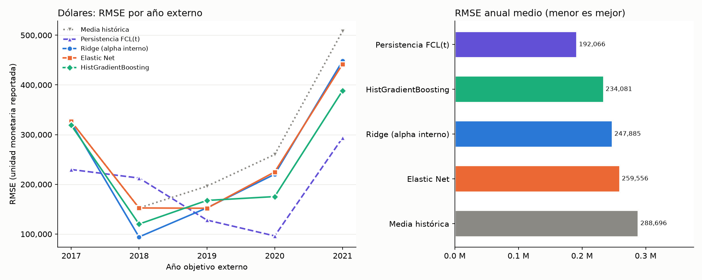
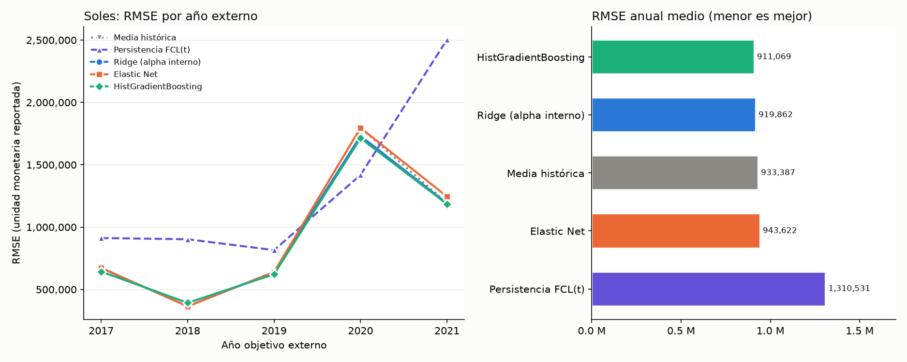

# Sprint 08 — Comparación acotada de modelos (exploratoria)

**Carácter.** EXPLORATORIA: años externos 2017–2021 ya examinados en la ablación y su revisión; la elección del ganador no es una estimación independiente. reports/sprint_08/instrucciones_claude.md (Etapa 1) excluía entrenar modelos nuevos; este encargo autoriza una comparación acotada como continuación del Sprint 08. Solo entrenamiento (años objetivo ≤ 2021), por moneda; prueba 2022–2025 no interviene; los 26 atributos de E2 se conservan sin selección.

## Respuestas

### D lares

1. **Menor RMSE observado:** persistencia (orden por RMSE anual medio: persistencia < boosting < ridge < elastic_net < media_historica). **Superioridad consistente frente a todos:** persistencia. **Modelo vigente:** persistencia. **Cambio recomendado:** Sustituir ridge por persistencia (exploratorio; requiere confirmación en datos no examinados).
2. **Frente a las referencias y Ridge:** Elastic Net frente a media histórica: RMSE -10.09 %, MAE -8.86 %, mejor en 3/5 años (no cumple la regla); Elastic Net frente a persistencia: RMSE +35.14 %, MAE +54.36 %, mejor en 1/5 años (no cumple la regla); Elastic Net frente a Ridge: RMSE +4.71 %, MAE +7.23 %, mejor en 2/5 años (no cumple la regla); boosting frente a media histórica: RMSE -18.92 %, MAE -19.08 %, mejor en 5/5 años (cumple la regla); boosting frente a persistencia: RMSE +21.87 %, MAE +37.05 %, mejor en 1/5 años (no cumple la regla); boosting frente a Ridge: RMSE -5.57 %, MAE -4.79 %, mejor en 3/5 años (no cumple la regla). Elastic Net recomendado: no; boosting recomendado: no.
   Ridge: Ridge frente a media histórica: RMSE -14.14 %, MAE -15.00 %, mejor en 5/5 años (cumple la regla); Ridge frente a persistencia: RMSE +29.06 %, MAE +43.95 %, mejor en 1/5 años (no cumple la regla).
3. **Consistencia:** la empresa con mayor error cuadrático acumula boosting 44%, Elastic Net 42%, media histórica 45%, persistencia 60%, Ridge 43% del error cuadrático externo (empresa más frecuente: B20027). Sensibilidad descriptiva y posterior al análisis (excluye de la evaluación a CM0006, sin reajustar; no modifica la decisión): menor RMSE observado persistencia, superioridad consistente persistencia (orden: persistencia < boosting < ridge < elastic_net < media_historica).
4. **Conclusión:** Sustituir ridge por persistencia (exploratorio; requiere confirmación en datos no examinados). persistencia cumple la regla frente a los otros 4 procedimientos. La conclusión se mantiene en la sensibilidad sin la empresa dominante. Exploratorio: los años externos ya se examinaron.

### Soles

1. **Menor RMSE observado:** boosting (orden por RMSE anual medio: boosting < ridge < media_historica < elastic_net < persistencia). **Superioridad consistente frente a todos:** ninguna. **Modelo vigente:** Ridge. **Cambio recomendado:** Conservar ridge; no se recomienda sustituirlo.
2. **Frente a las referencias y Ridge:** Elastic Net frente a media histórica: RMSE +1.10 %, MAE +2.76 %, mejor en 0/5 años (no cumple la regla); Elastic Net frente a persistencia: RMSE -28.00 %, MAE -1.95 %, mejor en 4/5 años (cumple la regla); Elastic Net frente a Ridge: RMSE +2.58 %, MAE +4.64 %, mejor en 0/5 años (no cumple la regla); boosting frente a media histórica: RMSE -2.39 %, MAE -11.42 %, mejor en 4/5 años (cumple la regla); boosting frente a persistencia: RMSE -30.48 %, MAE -15.48 %, mejor en 4/5 años (cumple la regla); boosting frente a Ridge: RMSE -0.96 %, MAE -9.80 %, mejor en 4/5 años (no cumple la regla). Elastic Net recomendado: no; boosting recomendado: no.
   Ridge: Ridge frente a media histórica: RMSE -1.45 %, MAE -1.79 %, mejor en 5/5 años (cumple la regla); Ridge frente a persistencia: RMSE -29.81 %, MAE -6.29 %, mejor en 4/5 años (cumple la regla).
3. **Consistencia:** la empresa con mayor error cuadrático acumula boosting 49%, Elastic Net 49%, media histórica 48%, persistencia 63%, Ridge 50% del error cuadrático externo (empresa más frecuente: B80004). Sensibilidad descriptiva y posterior al análisis (excluye de la evaluación a B80004, sin reajustar; no modifica la decisión): menor RMSE observado Ridge, superioridad consistente ninguna (orden: ridge < boosting < elastic_net < media_historica < persistencia).
4. **Conclusión:** Conservar ridge; no se recomienda sustituirlo. Ningún procedimiento cumple la regla frente a todos. boosting tiene el menor RMSE observado; frente a ridge: RMSE -0.956 %, MAE -9.80 %, menor RMSE en 4 de 5 años; no cumple el criterio predefinido para sustituirlo (RMSE -0.956 % no alcanza -1 %). Mantener ridge no demuestra que supere a boosting, ni equivalencia entre ambos, ni inutilidad de boosting: la evidencia no alcanza el criterio de cambio. En la sensibilidad sin la empresa dominante el orden cambia; la decisión no se basa en ella. Exploratorio: los años externos ya se examinaron.

### Listo para cerrar el Sprint 08

Auditoría de calidad (Etapa 1), ablación individual, validación anidada y su revisión, y esta comparación, con código, pruebas, notebooks y reportes reproducibles. Pendiente fuera de este sprint: evaluar cualquier cambio de modelo en datos no examinados.

## Protocolo (fijado antes de ejecutar)

- Validación: 3 últimos años antes del externo, ventana expansiva, >= 8 años de historia (mismo código que la revisión); años externos 2017, 2018, 2019, 2020, 2021; criterio promedio simple del RMSE de los años internos; sin validación aleatoria.
- Ridge: alpha 0.1, 1, 10, 100, 1000, 10000, 100000, 1e+06. Elastic Net: alpha 0.001, 0.01, 0.1, 1.0 × l1_ratio 0.1, 0.5, 0.9, max_iter 10000, objetivo estandarizado en cada entrenamiento. Boosting (HistGradientBoostingRegressor): max_depth (2, 3), max_iter (100, 300), l2 (0.0, 10.0), learning_rate 0.05, min_samples_leaf 20, early_stopping=False, random_state=0, NaN nativos.
- Máximo de configuraciones: {'ridge': 8, 'elastic_net': 12, 'boosting': 8}. Desempate: diferencia relativa <= 1e-09 en el RMSE interno medio: configuración más simple (Ridge/Elastic Net: mayor alpha, luego mayor l1_ratio; boosting: menor profundidad, menos iteraciones, mayor l2). Fallos: una configuración con excepción, predicción no finita o ConvergenceWarning en cualquier pliegue interno queda excluida de la selección de ese año externo; si el ajuste externo de la configuración elegida emite ConvergenceWarning se registra y se marca; si ninguna configuración es válida, el modelo no se evalúa en ese año.
- Regla: un modelo se recomienda frente a un comparador si su RMSE anual medio es <= -1 %, su RMSE es menor en >= 4 de 5 años y su MAE anual medio no es mayor. Un modelo nuevo (Elastic Net o boosting) se recomienda solo si cumple frente a media histórica, persistencia y Ridge. Decisión: el modelo vigente (Ridge) solo se sustituye por un procedimiento que cumpla la regla frente a todos los demás (superioridad consistente); el menor RMSE observado se reporta por separado y no implica superioridad consistente. (Aclaración de etiquetas tras la auditoría; la regla y los umbrales no cambian.) No es significancia estadística.
- Versiones: {'python': '3.12.15', 'scikit-learn': '1.9.1', 'numpy': '2.5.4', 'pandas': '3.0.6'}.

## Métricas externas por procedimiento

| moneda | procedimiento | RMSE anual medio | MAE anual medio | RMSE concatenado | MAE concatenado |
|---|---|---|---|---|---|
| D lares | persistencia | 192,066 | 89,316 | 202,295 | 88,174 |
| D lares | boosting | 234,081 | 122,406 | 249,959 | 120,985 |
| D lares | ridge | 247,885 | 128,570 | 272,219 | 126,001 |
| D lares | elastic_net | 259,556 | 137,866 | 276,917 | 135,850 |
| D lares | media_historica | 288,696 | 151,261 | 309,286 | 149,730 |
| Soles | boosting | 911,069 | 233,320 | 1,017,829 | 230,565 |
| Soles | ridge | 919,862 | 258,677 | 1,029,430 | 255,780 |
| Soles | media_historica | 933,387 | 263,398 | 1,051,246 | 260,377 |
| Soles | elastic_net | 943,622 | 270,676 | 1,062,641 | 267,400 |
| Soles | persistencia | 1,310,531 | 276,048 | 1,440,228 | 272,859 |

Promedio anual = criterio (cada año pesa igual); concatenadas = todas las predicciones externas juntas (pesan por n). Detalle por año: `metricas_por_anio.csv`; comparaciones anuales: `comparaciones_pareadas.csv`; resumen pareado completo: `resumen_comparaciones.csv`.

## Hiperparámetros elegidos (búsqueda interna)

| moneda | año externo | Ridge | Elastic Net | boosting |
|---|---|---|---|---|
| D lares | 2017 | {"alpha": 10000.0} | {"alpha": 1.0, "l1_ratio": 0.9} | {"max_depth": 2, "max_iter": 100, "l2_regularization": 10.0} |
| D lares | 2018 | {"alpha": 1000.0} | {"alpha": 1.0, "l1_ratio": 0.9} | {"max_depth": 2, "max_iter": 100, "l2_regularization": 10.0} |
| D lares | 2019 | {"alpha": 1000.0} | {"alpha": 1.0, "l1_ratio": 0.1} | {"max_depth": 2, "max_iter": 100, "l2_regularization": 10.0} |
| D lares | 2020 | {"alpha": 1000.0} | {"alpha": 1.0, "l1_ratio": 0.1} | {"max_depth": 2, "max_iter": 100, "l2_regularization": 0.0} |
| D lares | 2021 | {"alpha": 1000.0} | {"alpha": 1.0, "l1_ratio": 0.1} | {"max_depth": 2, "max_iter": 100, "l2_regularization": 10.0} |
| Soles | 2017 | {"alpha": 1000000.0} | {"alpha": 1.0, "l1_ratio": 0.9} | {"max_depth": 3, "max_iter": 100, "l2_regularization": 10.0} |
| Soles | 2018 | {"alpha": 1000000.0} | {"alpha": 1.0, "l1_ratio": 0.9} | {"max_depth": 3, "max_iter": 100, "l2_regularization": 10.0} |
| Soles | 2019 | {"alpha": 1000000.0} | {"alpha": 1.0, "l1_ratio": 0.9} | {"max_depth": 3, "max_iter": 100, "l2_regularization": 10.0} |
| Soles | 2020 | {"alpha": 10000.0} | {"alpha": 1.0, "l1_ratio": 0.9} | {"max_depth": 3, "max_iter": 100, "l2_regularization": 10.0} |
| Soles | 2021 | {"alpha": 10000.0} | {"alpha": 0.01, "l1_ratio": 0.5} | {"max_depth": 3, "max_iter": 100, "l2_regularization": 10.0} |

- Configuraciones internas descartadas por fallo o falta de convergencia: 0 de 280. Ajustes externos sin convergencia: 0.
- Elastic Net elige el alpha máximo de su rejilla (1) en 9 de 10 años externos: su regularización óptima podría ser mayor, lo que lo acercaría a la media histórica. Boosting elige el menor número de iteraciones en 10 de 10. Conforme al protocolo, las rejillas no se amplían tras ver resultados; es una limitación documentada.
- Persistencia con respaldo en la media: D lares 0 de 119 filas; Soles 6 de 829 filas.
- Referencias y Ridge reproducen la revisión anterior (diferencia relativa máxima: media_historica 8.2e-16, persistencia 8.2e-16, ridge 4.5e-15).
- Tiempos de ajuste: `tiempos_ajuste.csv` (no deterministas; se excluyen de la comparación byte a byte).

## Concentración del error por empresa

| moneda | procedimiento | empresa dominante | proporción | top-3 |
|---|---|---|---|---|
| D lares | boosting | CM0006 | 44.1% | 85.2% |
| D lares | elastic_net | B20027 | 41.9% | 84.8% |
| D lares | media_historica | B20027 | 44.7% | 89.5% |
| D lares | persistencia | CM0006 | 59.9% | 89.3% |
| D lares | ridge | B20027 | 43.5% | 85.3% |
| Soles | boosting | B80004 | 48.5% | 82.2% |
| Soles | elastic_net | B80004 | 49.2% | 81.5% |
| Soles | media_historica | B80004 | 47.5% | 83.1% |
| Soles | persistencia | B80004 | 63.3% | 87.5% |
| Soles | ridge | B80004 | 50.2% | 82.7% |

## Gráficos

## Limitaciones

- Exploratoria: los años 2017–2021 ya se examinaron; elegir el ganador con ellos sesga a favor del ganador. No es una estimación independiente.
- Cinco años externos por moneda; dólares con 21–26 filas por año. La regla no es una prueba de significancia; las empresas no son independientes entre años.
- El RMSE en unidades monetarias está dominado por pocas empresas (tabla anterior); la escala monetaria no está acreditada.
- Sin fechas de publicación ni vintages: persistencia y atributos suponen conocidos los estados de t al pronosticar.
- Rejillas pequeñas y fijas; en soles, Ridge ya alcanzaba el máximo de su rejilla en la revisión (limitación heredada, no se amplía).
- Cambios del usuario en archivos rastreados presentes y no modificados: notebooks/03_extraccion_macroeconomica.ipynb, reports/auditoria_extraccion_macroeconomica.md.

## Reproducción

`python scripts/reproduce_comparacion_modelos.py`; pruebas: `python -m unittest tests.test_comparacion_modelos -v`; notebook: `notebooks/sprint_08/13_comparacion_modelos.ipynb`.
